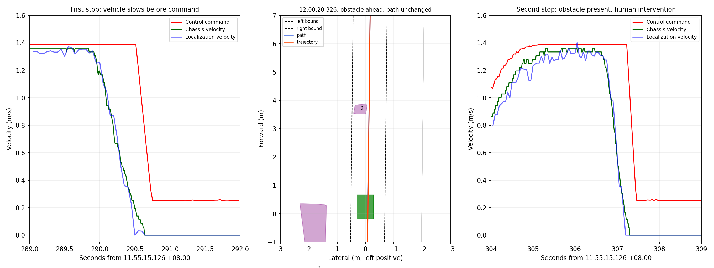

# tracking1028 三车道避障录包分析

分析对象：`/home/tang/autoware_bag/tracking1028`，2026-10-28 11:55:15.126–12:05:40.780（UTC+8），约 625.65 秒。用户确认车辆和地图为 `yunle_vehicle + map_task1`，且测试中存在人工遥控或急停干预。

**确认了左侧车道上“障碍物已识别，但最终路径没有绕行”的案例；当前录包不足以确定避障模块内部的拒绝原因。之前提出的“选错绕行方向”不能解释全部现象。**



## 1. 这份包没有形成三条车道的对照试验

唯一一条记录的路线，其首选车道依次为：

`30112 → 950312 → 970002（掉头连接）→ 950214 → 930114`。

除连接段外，它们都是各自行驶方向的最左侧车道。结合当前地图的车道多边形、车辆位置与航向，在路线相关车道中未发现车辆进入中间车道的定位采样。不能用这份包单独验证“中间车道能绕、左右车道不能绕”的完整对照结论。

当前地图包含几何重叠的反向车道和其他路线车道，分析时使用 Lanelet2 加载后的边界方向、车辆航向和记录路线进行区分，不能只根据原始 OSM way 的点序判断车道方向。

## 2. 明确的未绕行片段：12:00:20–12:00:22

车辆位于最左侧车道 `950214`。障碍物跟踪 ID 为 `1cd70000000000001fbff9490c8c1523`，感知类别为 `UNKNOWN`（0）。以下距离以车辆后轴参考位置投影到已发布行为路径的弧长为基准，横向正值为路径左侧，采用原始障碍物多边形，没有额外膨胀。

| 时间（UTC+8） | 障碍物最近边缘在前方 | 障碍物横向范围 | 车辆速度 | 前方 5 米行为路径相对地图中心线 |
|---|---:|---:|---:|---|
| 12:00:20.326 | 3.52 m | 左侧 0.07–0.54 m | 1.30 m/s | 无可见偏移，计算偏差 < 0.01 m |
| 12:00:21.126 | 2.46 m | 左侧 0.08–0.61 m | 1.33 m/s | 无可见偏移，计算偏差 < 0.01 m |
| 12:00:22.126 | 1.35 m | 左侧 0.09–0.60 m | 0.58 m/s | 无可见偏移，计算偏差 < 0.01 m |

此处车宽为 0.572 m，来自录包同时保存的控制器车辆参数，障碍物的横向范围与沿中心线行驶的车身范围重叠。不能解释为“完全没有识别到障碍物”或“障碍物明显在车身范围之外”。

12:00:20.326 的已发布路径左右边界距车辆参考点约为 0.52 m、0.68 m，总宽约 1.20 m，仍是当前单车道走廊。**这只是最终输出，不能据此证明静态避障内部从未扩展过候选可行驶区。**

当前源码按障碍物位于路径左侧来产生向右绕行的移位。这个案例的右侧正是中间车道。因此，即使增加“边车道向中间绕”的方向规则，也不能直接保证修复此片段。仍需确认对象是否进入目标集合、是否生成候选，以及候选是否被空间、纵向距离、运动约束、安全检查或模块仲裁拒绝。

## 3. 地图侧邻接关系检查通过

以当前 `map_task1/lanelet2_map.osm`、当前 `LocalCartesianUTM` 原点，以及 Lanelet2 Germany/Vehicle 交通规则离线构建路由图，得到：

| 左侧车道 | 可向右变道的中间车道 | 中间车道再向右 |
|---|---|---|
| 30112 | 30113 | 30114 |
| 950312 | 950313 | 50214 |
| 950214 | 50313 | 50312 |
| 930114 | 930113 | 930112 |

因此没有发现这些路段“边车道与中间车道不相邻或不可变道”的地图拓扑错误。此检查不等于重建了当时规划器的全部运行状态；包中没有 `/map/vector_map`。

## 4. 人工停车不能作为规划主动停车的证据

首段停车时，约 12:00:05 前车辆已经减速，但 `/control/command/control_cmd` 仍下发约 1.389 m/s。直到车速接近零后，速度指令才降至约 0.25 m/s。

第二段停车也有类似顺序：车辆先减速，前进指令仍保持约 1.389 m/s，停车后才降至约 0.25 m/s。用户已确认测试中存在人工遥控或急停干预。这两段不能记为 Autoware 检测障碍后主动刹停，也不能仅凭停车后的 0.25 m/s 推断是规划减速导致停车。

以定位速度绝对值 < 0.05 m/s、持续至少 2 秒提取的途中停车段如下；末尾终点停车单独列在 CSV 中。

| 开始时间 | 持续时间 | 路线车道 |
|---|---:|---|
| 12:00:05.625 | 11.75 s | 950214 |
| 12:00:22.326 | 9.00 s | 950214 |
| 12:01:04.875 | 12.60 s | 950214 |
| 12:01:25.375 | 3.10 s | 950214 |
| 12:01:41.274 | 5.00 s | 950214 |
| 12:02:55.125 | 6.20 s | 930114 |

这些是运动学停车区间，不能全部归为同一种停车原因。自动模式状态在上述途中区间均未切出 autonomous；底盘侧人工干预不一定反映为 Autoware 模式切换。

## 5. 尚缺的关键证据

录到了 `PredictedObjects`、行为路径、最终轨迹、定位、控制指令、底盘速度及诊断，但没有静态避障参考路径、候选路径、目标拒绝原因、内部状态与规划因素。辅助目录 `experiment_metadata/tracking1028` 保存了控制和底盘桥接参数，没有保存行为路径规划器参数。

当前工作区的静态避障 YAML 虽然允许同向借道、允许 UNKNOWN 目标，但不能把当前文件当成 10 月 28 日运行参数快照。因此本次没有调整避障阈值或直接修改方向算法。

下次保留原录制内容，并补录 [extra_topics.txt](extra_topics.txt) 中的话题。这些名称均来自本次实验保存的 `ros_topics.txt`。重点查看：

1. 静态避障 `debug` 中目标分类及拒绝原因，例如 `INSUFFICIENT_DRIVABLE_SPACE`、`INSUFFICIENT_LONGITUDINAL_DISTANCE`。
2. `path_reference` 与 `path_candidate`：区分未产生候选、候选被拒绝、候选产生但没有成为最终路径。
3. `drivable_lanes` 和 `internal_state`：确认借道范围和模块运行/仲裁状态。
4. 同步保存行为路径规划器运行参数，核对 `avoidance.use_lane_type`、UNKNOWN 目标开关、检测范围、横移限制及 RTC 设置。

运行节点存在时，可只读导出参数（本次分析没有连接或操作运行中的车辆）：

```bash
ros2 param dump /planning/scenario_planning/lane_driving/behavior_planning/behavior_path_planner > behavior_path_planner.runtime.yaml
ros2 param dump /planning/scenario_planning/lane_driving/motion_planning/motion_velocity_planner > motion_velocity_planner.runtime.yaml
```

## 6. 复现与产物

原始 rosbag 以 SQLite `mode=ro` 打开，未播放到 ROS 网络，未修改原始录包或车辆配置。路径和对象按约 5 Hz 抽样，定位保留完整约 20 Hz；控制图使用相应窗口内完整控制/底盘速度消息。配对采用最近的接收时间；重点事件对象/路径配对误差 < 0.2 秒。未重建内部未发布的参考路径或精确复现全部规划算法。

在工作区执行：

```bash
source /opt/ros/humble/setup.bash
source install/setup.bash
python3 plots/tracking1028_avoidance/analyze.py
python3 plots/tracking1028_avoidance/evidence.py
```

- [关键证据图](key_evidence.png)：两次人工停车的指令顺序、第二段未绕行时的障碍物与路径。
- [全程轨迹和速度](overview.png)。
- [停车期间局部快照](stop_snapshots.png)：注意这些是停车期间，不一定是最初触发干预的时刻。
- [重点事件数值](key_event.json)、[地图邻接](map_neighbors.json)。
- [停车时间表](stops.csv)、[控制与底盘速度样本](control_samples.csv)。
