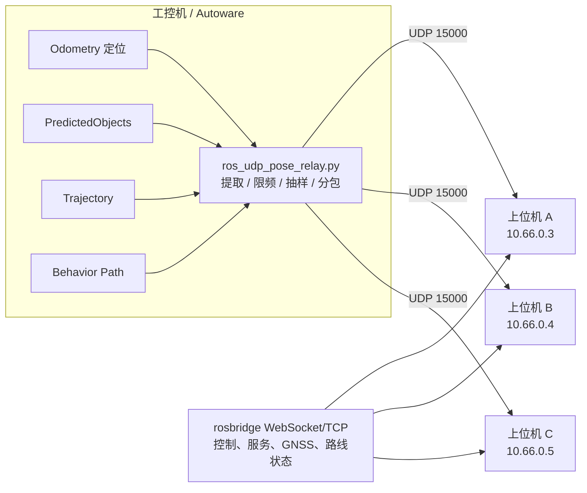

# ROS 2 UDP 遥测转发（不依赖 `/web/*`）

`ros_udp_pose_relay.py` 直接订阅 Autoware 原始话题，在工控机上提取网页真正需要的数据，再通过同一个 UDP 端口发送：

| 数据 | 原始话题 | UDP 类型 | 默认频率 | 内容 |
|---|---|---|---:|---|
| 定位 | `/localization/kinematic_state` | `pose` | 10 Hz | 位置、姿态、线速度 |
| 障碍物 | `/perception/object_recognition/objects` | `objects` | 5 Hz | 短 ID、中心、yaw、长宽高 |
| 控制轨迹 | `/planning/scenario_planning/trajectory` | `trajectory` | 3.5 Hz | 均匀抽样后的二维点列 |
| 行为路径 | `/planning/scenario_planning/lane_driving/behavior_planning/path` | `path` | 1 Hz | 均匀抽样后的三维点列 |

网页不再主动订阅 `/web/objects`、`/web/trajectory`、`/web/behavior_path` 或 `/web/route`，可以停止旧 `web_relay`。

## 消息流程



每个 UDP 数据报目标上限为 1200 字节。障碍物、轨迹、路径超过限制时自动分包，上位机按 `type + seq + stamp + part/parts` 重组；800 ms 内不完整就丢弃，等待下一帧。

## 1. 确认原始话题和类型

```bash
source /opt/ros/$ROS_DISTRO/setup.bash
source ~/autoware/install/setup.bash

ros2 topic type /localization/kinematic_state
ros2 topic type /perception/object_recognition/objects
ros2 topic type /planning/scenario_planning/trajectory
ros2 topic type /planning/scenario_planning/lane_driving/behavior_planning/path
```

期望：

```text
nav_msgs/msg/Odometry
autoware_perception_msgs/msg/PredictedObjects
autoware_planning_msgs/msg/Trajectory
autoware_planning_msgs/msg/Path
```

如果名称不同，用下面对应的 `*_topic` 参数指定。

## 2. 工控机启动命令

工控机 WireGuard 地址为 `10.66.0.2`，默认直接向三台上位机
`10.66.0.3`、`10.66.0.4`、`10.66.0.5` 发送。离线目标不会阻塞其他目标：

```bash
source /opt/ros/$ROS_DISTRO/setup.bash
source ~/autoware/install/setup.bash

python3 ros_udp_pose_relay.py --ros-args \
  -p target_port:=15000 \
  -p max_datagram_bytes:=1200 \
  -p max_rate_hz:=10.0 \
  -p objects_enabled:=true \
  -p objects_rate_hz:=5.0 \
  -p trajectory_enabled:=true \
  -p trajectory_rate_hz:=3.5 \
  -p trajectory_max_points:=100 \
  -p path_enabled:=true \
  -p path_rate_hz:=1.0 \
  -p path_max_points:=300
```

参数说明：

- `target_ips`：多台上位机 WireGuard 地址，默认是
  `10.66.0.3`、`10.66.0.4`、`10.66.0.5`。
- `target_ip`：兼容原单目标方式；显式设置后会覆盖 `target_ips`。
- `target_port`：每台上位机的 UDP 监听端口。
- `max_datagram_bytes`：单个 UDP 报文上限，建议保持 1200。
- `max_rate_hz`：定位发送频率。
- `objects_rate_hz`：障碍物 bounding box 发送频率。
- `trajectory_max_points`：控制轨迹最多保留多少点；均匀抽样并保留首尾。
- `path_max_points`：行为路径最多保留多少点。
- 各 `*_enabled` 可独立关闭一种 UDP 数据。

自定义话题示例：

```bash
-p topic:=/实际定位话题 \
-p objects_topic:=/实际障碍物话题 \
-p trajectory_topic:=/实际轨迹话题 \
-p path_topic:=/实际行为路径话题
```

## 3. 上位机配置

`public/config.json`：

```json
"rosUdpTelemetry": {
  "enabled": true,
  "listenAddress": "0.0.0.0",
  "listenPort": 15000,
  "allowedSource": "10.66.0.2",
  "fallbackMs": 3000,
  "objectsEnabled": true,
  "objectsFallbackMs": 3000,
  "trajectoryEnabled": true,
  "trajectoryFallbackMs": 3000,
  "pathEnabled": true,
  "pathFallbackMs": 4000
}
```

- `allowedSource` 填写工控机的 WireGuard 地址 `10.66.0.2`；首次联调可暂时留空。
- `fallbackMs` 是定位 UDP 超时。
- 其余三个 `*FallbackMs` 分别控制障碍物、轨迹、路径的回退时间。
- 每台上位机都可以监听自己的本地 UDP 15000。

Windows 管理员 PowerShell：

```powershell
New-NetFirewallRule -DisplayName "核星力 ROS UDP 遥测" -Direction Inbound -Protocol UDP -LocalPort 15000 -Action Allow
```

## 4. WebSocket 保留内容

停止 `/web/*` 后，以下数据仍通过 rosbridge WebSocket/TCP：

- `/api/routing/state`、`/api/routing/route`：路线状态和终点。
- GNSS、控制回显、操作模式和定位初始化状态。
- 发布起点、终点、控制和障碍物操作命令。
- ROS service 调用，例如定位初始化、停车、切换自动驾驶、清除路线。

这些操作需要可靠送达，不改成裸 UDP。

## 5. 自动回退

每类数据独立检测：

```text
UDP 正常 → 不订阅对应的原始大话题
UDP 超时 → 只订阅对应的 Autoware 原始话题
UDP 恢复 → 自动退订该原始话题
```

不会再尝试 `/web/*`。

## 6. WireGuard 多机直发

工控机把每个紧凑 UDP 数据报直接发送到：

```text
10.66.0.3:15000
10.66.0.4:15000
10.66.0.5:15000
```

不需要登录云服务器或运行云端 fan-out；公网仍只使用 WireGuard 的
`51820/UDP`。三台上位机各自在 Windows 防火墙中允许本机 `15000/UDP`。

## 7. 验证

工控机检查原始数据：

```bash
ros2 topic hz /localization/kinematic_state
ros2 topic hz /perception/object_recognition/objects
ros2 topic hz /planning/scenario_planning/trajectory
ros2 topic hz /planning/scenario_planning/lane_driving/behavior_planning/path
```

上位机控制台应依次看到：

```text
UDP 实时定位已接通
UDP bounding-box 障碍物已接通
UDP 控制轨迹已接通
UDP 行为路径已接通
```
